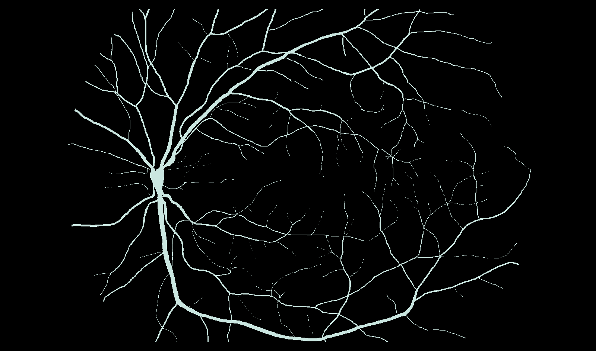
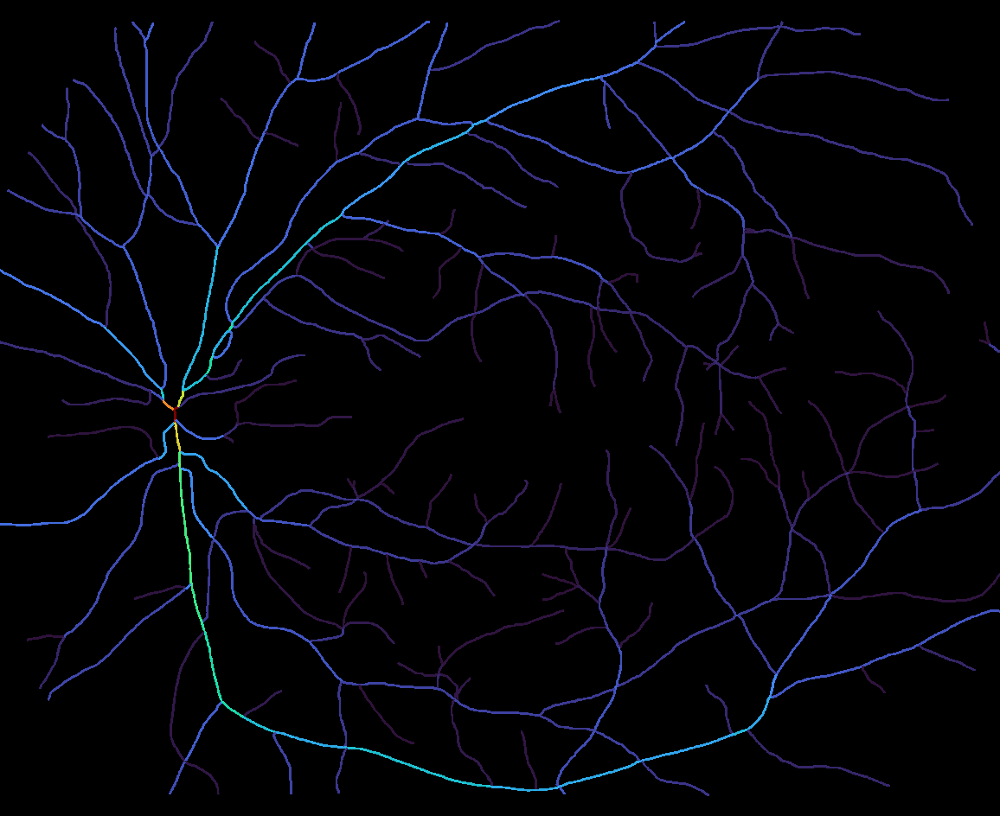
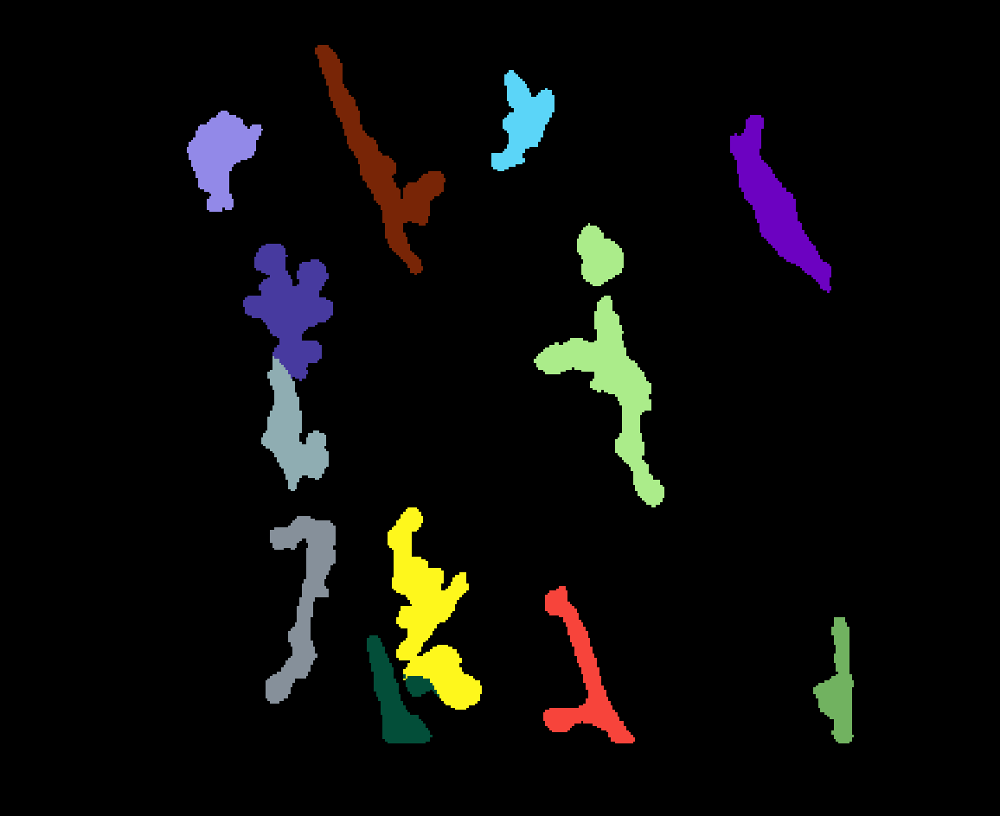
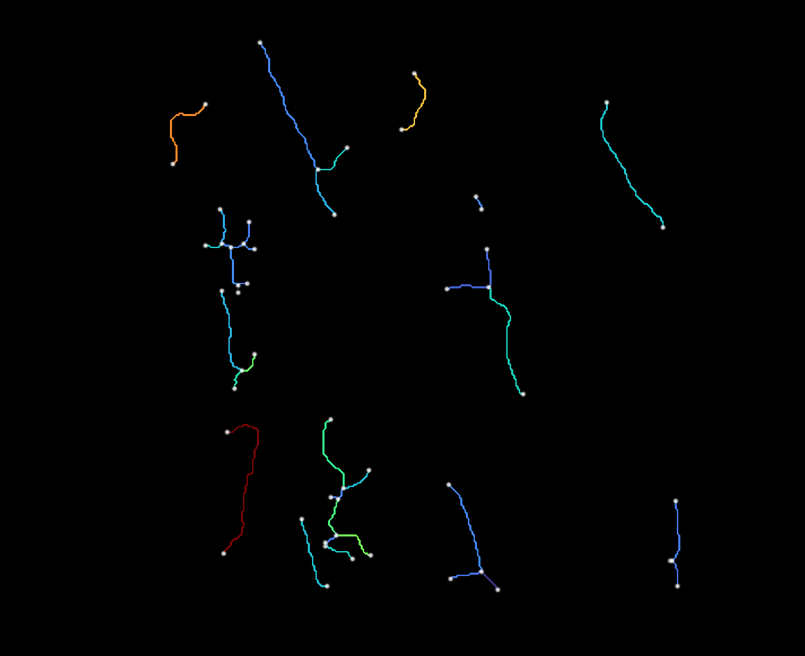

Skeletonization and graph-based feature extraction for branching biological structures — vasculature, fibers, neurites, and other network-like objects — from 2D or 3D binary or multi-label segmentation masks.

Maskel is the core algorithm package: thinning, feature extraction, and the CLI. It has no napari dependency — for the interactive napari plugin, see **[napari-maskel](https://bionetslab.github.io/napari-maskel/)**. For benchmarks and the HRF-based analysis notebooks, see [maskel-evaluations](https://github.com/bionetslab/maskel-evaluations) on GitHub.

## What it does

Given a 2D or 3D segmentation mask — either a plain binary mask or a multi-object instance segmentation map — from any imaging modality or biological structure, maskel:

1. Optionally preprocesses the binary mask (morphological closing, hole filling)
2. Thins it to a 1-pixel/voxel skeleton (a fast, Numba-parallelized implementation of Lee et al. 1994 thinning)
3. Builds a graph over the skeleton (edges = branches between junctions/endpoints; the raw node table before filtering covers every skeleton pixel, degree-2 pass-through points included — see [Node-level features](glossary.md#node-level-features-image_nodescsv))
4. Optionally prunes short spur branches and cleans up ambiguous triangle junctions
5. Extracts per-branch, per-node, and per-object summary features (length, tortuosity, radius, fractal dimension, ...)

Touching-but-distinct objects in a multi-object mask are always skeletonized independently, never merged.

## Examples

### 2D binary mask



This is an example of running maskel on a 2D binary segmentation mask. The data is from the [HRF (High-Resolution Fundus) image database](https://www5.cs.fau.de/research/data/fundus-images/) — a manually annotated retinal vessel mask.



The extracted skeleton, colored here by each branch's mean radius (`mean_radius` in `<image>_branches.csv`) — rendered from the exported branch CSV for illustration, since maskel's CLI itself only writes data (voxel lists, CSVs, graphs) — never a rendered/annotated visualization like this one. Use the exported `.graphml`/`.pkl` graph, or [napari-maskel](https://bionetslab.github.io/napari-maskel/), to visualize interactively.

### 2D multi-label mask



A multi-object instance segmentation map (more than one distinct nonzero label) is skeletonized independently per object — including two objects that touch, which stay correctly separate rather than merging into one skeleton. This example is the first frame of a video, `MacrophageData_V2/NpyData/EMMACtrl_2021-05-19_visual_labels.npy`, from [Zenodo record 13929787](https://zenodo.org/records/13929787).



Every branch, node, and summary row is tagged with the `object_id` it came from, so the per-object rows in `<image>_summary.csv`/`<image>_branches.csv`/`<image>_nodes.csv` stay consistent with the IDs in the original mask. Running `maskel run` on every frame of this video with the same config — tuned on this one example frame — reproducibly extracts these same per-object features across the whole sequence.

## General usage of the CLI

1. Create a starter config: `maskel init config.json`.
2. Edit `config.json` to set the parameters described below.
3. Check it's well-formed: `maskel validate config.json` — prints the normalized config and confirms its `schema_version` is supported.
4. Run it:

```sh
maskel run --input image.tif --config config.json --out outputs
```

### Stages

A run has three stages, each also available as its own command:

1. `maskel skeletonize` — mask → voxel list `<image>_voxels.h5`: preprocessing, thinning and the radius of every skeleton voxel.
2. `maskel postprocess` — voxel list → cleaned voxel list `<image>_voxels_post.h5`: junction cleanup and spur pruning, on the skeleton graph. Voxels added by junction cleanup get estimated radii.
3. `maskel features` — voxel list → feature tables and graphs.

`maskel run` does all three and writes both voxel lists. `postprocess` and `features` take a voxel list as `--input`, so stage 2 or 3 can be re-run with other settings without thinning again.

A voxel list is an HDF5 file with the datasets `coords` (global voxel indices), `radius` and `label` (one row per skeleton voxel), per-label mask statistics under `labels/`, and the image shape, spacing and config as attributes.

### Input

`--input` is one image: `.h5`/`.hdf5` (pick the dataset with `--dataset` when the file holds more than one), `.png`, `.jpg`, `.jpeg`, `.tif`, `.tiff`, `.bmp`, `.npy` or `.mhd`. It is either a plain binary segmentation mask or a multi-object instance segmentation map (see Examples above for how the latter is handled).

### Large images: tiles

`--tile-shape N` (one value, or one per axis) splits the image into tiles that are processed one at a time, so only one tile has to fit in memory. Tiling needs HDF5 input; other formats are always loaded whole, so `--tile-shape` with them is rejected before anything is read. Without `--tile-shape` the whole image is a single tile. Tiled and untiled runs give the same result as long as the halo is large enough.

`--halo N` (one value, or one per axis; default `100`) is how many voxels are read around each tile for the thinning. As a rule of thumb it should be about 2 × the largest vessel radius in voxels, per axis (measured needs were 0.5–2 ×; Lee94 thinning has no strict bound); each finished tile is checked against that rule, and a warning names the tile and the halo it would need, so a long run can be stopped early. Preprocessing adds its own margin on top.

`--tile-shape auto --max-diameter D` sizes the tiles automatically. `D` is the diameter of the largest structure of interest, in `spacing` units (voxels without spacing). The halo is set to 2 × its radius per axis (`D / spacing`), and the tile cores are made proportional to the halo and as large as possible while each read block, at about 8 bytes per voxel, fits into the free memory divided by `--jobs`. With more than one job the cores are made smaller where needed to give about 3 tiles per job, so a worker that finishes early can pick up the next tile, but never below 10 × the halo per axis. The chosen core, halo, tile count and read overhead are printed before the run. `--halo` is not used in this mode, and `--max-diameter` only in this one; `--halo` without `--tile-shape` is rejected as well.

`--jobs N` (`-j`) processes `N` tiles at the same time, each in its own process (HDF5 input only; `0` uses all cores). The result is identical to a serial run. Memory grows by about one tile per job, so `--jobs` and `--tile-shape` together set the memory budget. More jobs than tiles or CPU cores are capped, with a warning. Calling `maskel.skeletonize.skeletonize(..., jobs=N)` from your own script needs the usual `if __name__ == "__main__":` guard, since the workers are started fresh.

### Checks before the run

Before any tile is processed, a run stops with an error when `--tile-shape` or `--jobs` is used with a non-HDF5 input, when `fill_holes` has no `max_hole_diameter` but there is more than one tile, or when the largest tile, read with its halo, would not fit into free memory `--jobs` times over (estimated at the input's bytes per voxel plus about 8 bytes per voxel per tile; measured on vessel masks with a few percent foreground, denser masks need more). It warns when the halos make the run read more than twice the volume.

### Output

`--out` is a directory that ends up containing the voxel lists and whichever files are enabled under `output` (summary/branch/node CSVs, GraphML/pickle graphs — see Configurable parameters below for exact filenames).

## Configurable parameters

A config JSON has a `schema_version` (currently 8, must match exactly), a top-level `spacing`, and one block per stage plus the outputs: `preprocessing`, `postprocessing`, `feature_extraction` and `output`, matching `maskel.config.PipelineConfig` and its `PreprocessingConfig`/`PostprocessingConfig`/`FeatureConfig`/`OutputConfig`. It's the JSON produced by `maskel init` and consumed by `maskel run --config`. Configs of an older schema version are rejected; create a new one with `maskel init`.

```json
{
  "schema_version": 8,
  "spacing": null,
  "preprocessing": {"opening_radius": 0, "closing_iterations": 0, "fill_holes": false, "max_hole_diameter": 0.0},
  "postprocessing": {"junction_cleanup": false, "cleanup_threshold_factor": 2.5, "prune_spurs": false, "min_spur_length": 10.0, "spur_iterations": 1},
  "feature_extraction": {"summary": true, "branches": false, "nodes": false, "fractal_dimension": false, "radius_features": false},
  "output": {"write_summary_csv": true, "write_branch_csv": false, "write_node_csv": false, "write_graphml": false, "write_networkx_graph": false, "write_skeleton_mask": false, "write_skeleton_radii": false}
}
```

### Physical spacing

- `spacing` (list[float] or `null`, default `null`) — per-axis physical pixel/voxel size (length must match the image's dimensionality: 2 for 2D, 3 for 3D; a mismatch is an error). When set, length/radius/area/volume features come out in physical units instead of pixel units. Box-counting `fractal_dimension` is only valid for isotropic voxels, so it's forced to `0.0` (with a warning) whenever spacing is set and anisotropic.

### Preprocessing

- `preprocessing.fill_holes` (bool, default `false`) — fill holes in the binary segmentation before thinning.
- `preprocessing.max_hole_diameter` (float, default `0`) — when `fill_holes` is true, only holes that fit in a box of this size per side are filled (in physical units once `spacing` is set, pixels otherwise); `0` fills all holes, which only works without tiling.
- `preprocessing.opening_radius` (int, default `0`) — radius in voxels of the ball (3D) / disk (2D) used for a morphological opening before thinning; `0` disables it. Removes thin bridges, flaps and specks the ball doesn't fit into. Runs before the closing. Same border handling as the closing.
- `preprocessing.closing_iterations` (int, default `0`) — radius in voxels of the ball (3D) / disk (2D) used for a morphological closing before thinning; `0` disables it. Away from the array border this gives the same result as `skimage.morphology.closing(mask, ball(r))`. At the border, the edge voxels are repeated outward first, so objects touching it are neither eroded nor treated as ending there (skimage instead treats the outside as foreground, which also fills background strips narrower than the radius along the border). (The key keeps its old name for config compatibility; radius 1 equals one iteration of the old cross-shaped closing.)

### Postprocessing

- `postprocessing.junction_cleanup` (bool, default `false`) — clean up ambiguous junction pixel clusters left behind by thinning.
- `postprocessing.cleanup_threshold_factor` (float, default `2.5`) — sensitivity for the above; higher values collapse larger clusters.
- `postprocessing.prune_spurs` (bool, default `false`) — remove short endpoint-to-junction branches that are thinning artifacts rather than real structure.
- `postprocessing.min_spur_length` (float, default `10.0`) — branches shorter than this qualify as spurs; in pixel units, or physical units once `spacing` is set.
- `postprocessing.spur_iterations` (int, default `1`) — how many times pruning repeats on its own output, since removing one spur can expose another.

### Feature extraction

- `feature_extraction.summary` (bool, default `true`) — compute per-object summary features, written to `<image>_summary.csv` when `output.write_summary_csv` is also on.
- `feature_extraction.branches` (bool, default `false`) — extract per-branch features, written to `<image>_branches.csv` when `output.write_branch_csv` is also on.
- `feature_extraction.nodes` (bool, default `false`) — extract per-node features, written to `<image>_nodes.csv` when `output.write_node_csv` is also on.
- `feature_extraction.fractal_dimension` (bool, default `false`) — compute the skeleton's box-counting fractal dimension as a summary feature (see [Glossary](glossary.md)). Forced to `0.0` whenever `spacing` is set and anisotropic.
- `feature_extraction.radius_features` (bool, default `false`) — report the local radius (distance from each skeleton voxel to the nearest background voxel). Required for every radius/diameter/volume/surface_area feature at every level (object, branch, node).

### Output settings

- `output.write_summary_csv` (bool, default `true`) — write `<image>_summary.csv`, one row per object.
- `output.write_branch_csv` (bool, default `false`) — write `<image>_branches.csv` (requires `feature_extraction.branches`).
- `output.write_node_csv` (bool, default `false`) — write `<image>_nodes.csv` (requires `feature_extraction.nodes`).
- `output.write_graphml` (bool, default `false`) — write the skeleton graph as `<image>_<object_id>_graph.graphml`, one file per object (nodes = graph nodes, edges = branches).
- `output.write_networkx_graph` (bool, default `false`) — write the same graph as `<image>_<object_id>_graph.pkl`, a pickled `networkx.MultiGraph` — richer than GraphML (keeps NaN values and native Python types) but only readable from Python.
- `output.write_skeleton_mask` (bool, default `false`) — next to each voxel list, also write its skeleton as a binary image, `<image>_voxels_mask.h5` and `<image>_voxels_post_mask.h5` (one uint8 dataset `skeleton`, 1 on the skeleton, with a `spacing` attribute when set). The whole image is held in memory while writing.
- `output.write_skeleton_radii` (bool, default `false`) — like `write_skeleton_mask`, but each skeleton voxel holds its radius instead of 1: `<image>_voxels_radii.h5` and `<image>_voxels_post_radii.h5`, one float32 dataset `radius`, 0 on the background. Radii are in `spacing` units (voxels without spacing). Also held in memory whole while writing.

An `output.write_*` flag set without its required `feature_extraction.*` flag is rejected outright: both `maskel validate` and `maskel run --config` raise `ValueError` listing every mismatched pair, rather than silently writing nothing for that flag.

## Sharing a config with napari-maskel

napari-maskel still uses maskel 2.x and its schema-7 configs (**Save recipe**/**Load recipe**); those configs are not accepted by this version.

## License

Maskel is released under the **MIT License**. See [LICENSE](https://github.com/bionetslab/maskel/blob/main/LICENSE) for details.
